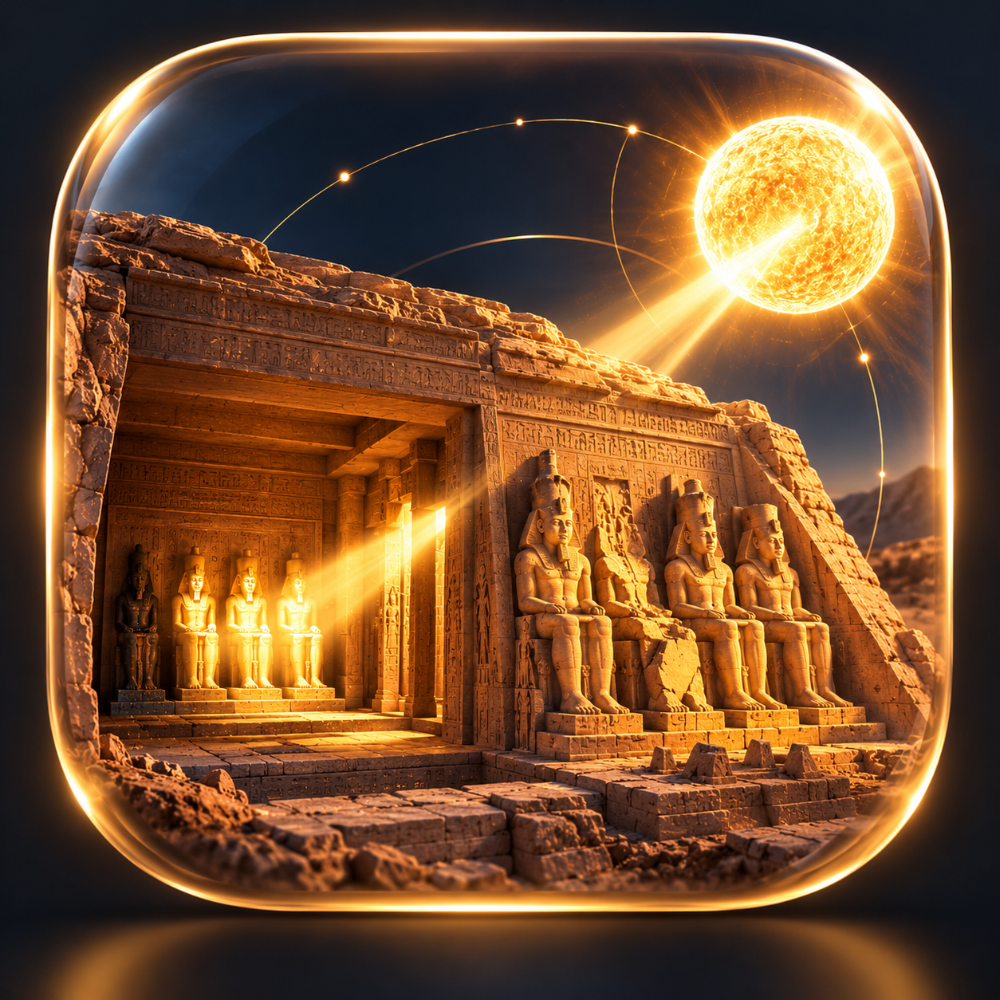
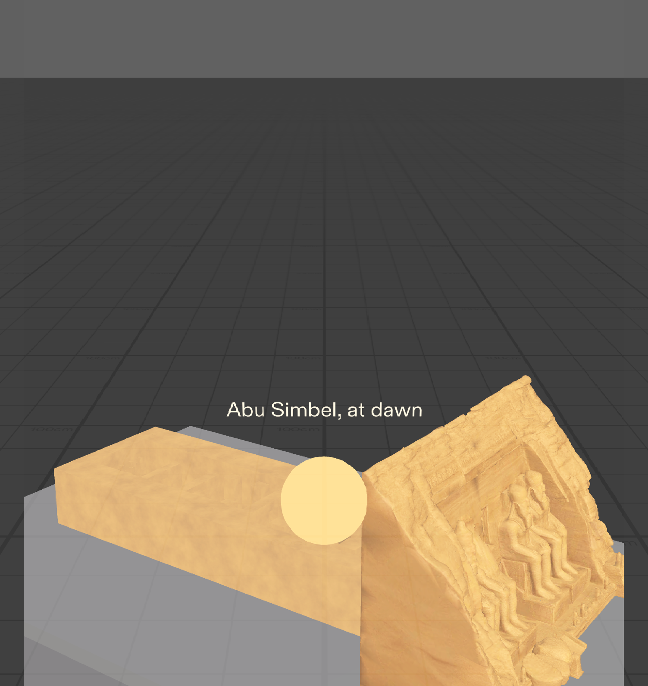
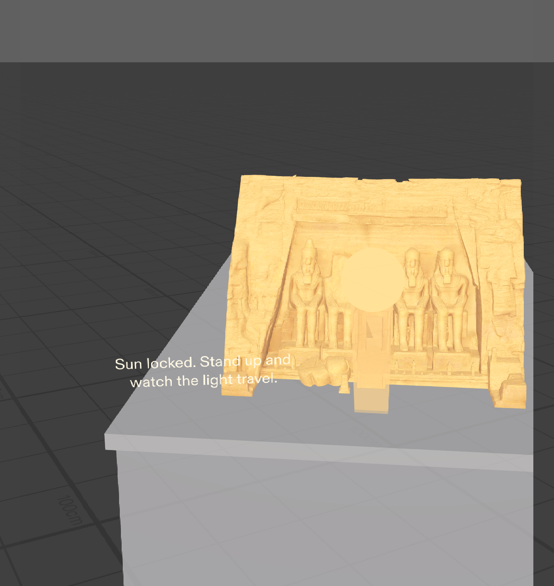
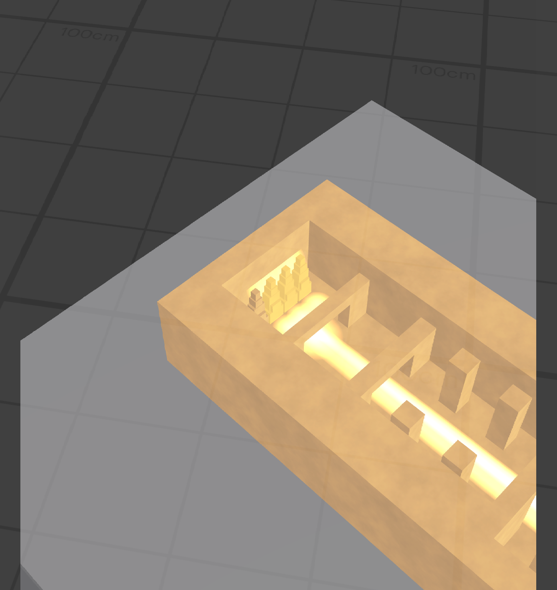
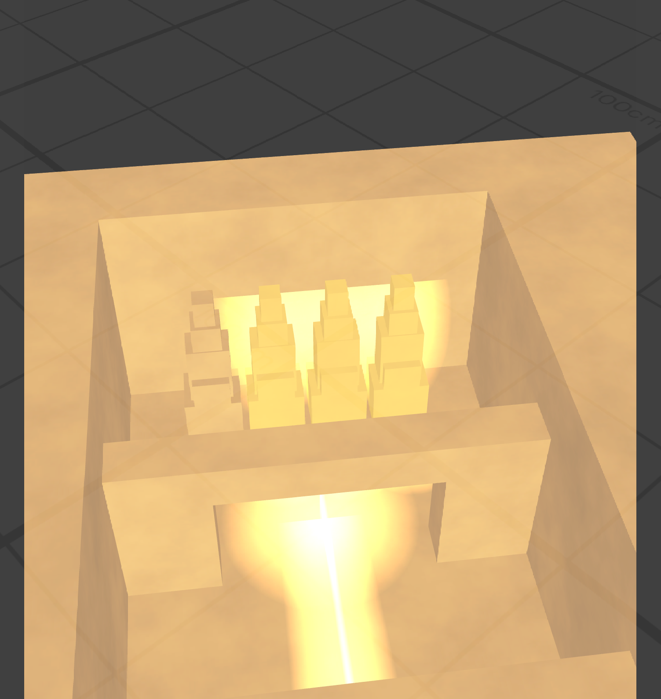

# Sunkeeper — The Secret of Abu Simbel

A SPECS Lens for **Learn AR with SPECS**, the Devpost learning hackathon.

Move through space, align the sun, and reveal a 3,000-year-old secret. A cut-away model of the Great Temple of Ramesses II (built c. 1264–1244 BCE) sits on a plinth in front of you. A glowing sun hangs on your side of the temple and follows you as you walk. Find the one spot where the real sun stands twice a year, low and straight in front of the entrance, and the light travels sixty metres through the halls to the sanctuary, where three of the four seated gods light up. Ptah, god of the underworld, stays in shadow.

## Who it is for

Curious travellers, students and museum visitors who want to understand *why* Abu Simbel is an engineering marvel, not just look at it. You learn the alignment by finding it with your own body.

## Why it needs glasses

Your body is the controller. On a phone you would point a screen at a model; here you walk around a miniature temple on a real table and your position sets the sun's angle. Your hands stay free and your eyes stay on the temple. The "aha" is physical: you have to get low and in front of the door, exactly where the sun stands at dawn on the alignment days. Nothing real is recognised or recorded; the Lens only needs the table surface and your head position.

## What happens

1. **Start.** The temple rises out of the plinth with a soft glow. "Abu Simbel, at dawn", then "Find where the sun must stand".
2. **Walk round.** The sun disc and a key light ride on the line from the temple to your head. A floor ring and a faint light shaft brighten as you near the spot on the temple axis.
3. **Get low and lock.** Inside the window (±7° of the axis, head 0–25° above the entrance, 50–150 cm out) for one second, the sun locks and the caption says "Now walk to the side and look inside." A softer ring marks the best viewing spot beside the plinth.
4. **The revelation.** Two seconds later a warm patch of light enters the doorway and travels the axis for eight seconds with a soft shaft behind it. When it arrives, Ra-Horakhty, Ramesses and Amun-Ra ease up to a warm gold with a halo and a pool of light, 0.8 s apart. Ptah stays plain sandstone.
5. **The story.** A 38-second recorded narration, with fourteen short captions near the sanctuary end cued to it, tells what you have just seen. Then "Try again" appears on the plinth corner; pinch it, or step well away, and everything fades back to the start.

## How it was built

- **Plan.** The Devpost Learn skill pack's `plan-lens` skill (a copy lives in `agent/skills/plan-lens/`) interviewed me and wrote `devpost/design-brief.md`: the one spatial moment, where things live, when things show, done criteria, the historical facts the build must respect, and the risks. Every later change is logged at the top of that file.
- **Build.** Snap's CLAD agent toolkit drove Lens Studio 5.24 through its MCP tools, milestone by milestone, with screenshots at each sign-off (`devpost/screenshots/`, camera poses in `m4-camera-poses.md`). All logic is TypeScript in `Assets/Scripts/`: `SunAlignment` (sun, key light, cues, lock), `SunReveal` (beam, statue lighting, fade-out), `SunNarration` (captions, Try again, step-away reset), `ViewingSpot`, `Onboarding`, `TempleEntrance`, `InteriorLift`. Interactions use the Spectacles Interaction Kit and UI Kit so they work with the mouse in the Interactive Preview.
- **Temple.** The façade is an image-to-3D model generated with Meshy AI. Inspection (`devpost/asset-review/findings.md`) showed its interior off the doorway axis with five sanctuary statues and six columns, so the interior was deleted and rebuilt on the axis with three headless Blender scripts in `tools/blender/`: inspect, build the hybrid (passage bored through the rock, eight Osiride pillars, four pillars, vestibule, four separate statues), then optimise and export `Assets/Temple/Temple.glb` (96k triangles, 2048 px textures, 10.6 MB).

## Design decisions

- **Additive display: contrast from light, not darkness.** On SPECS black is transparent, so "Ptah stays in darkness" is done the other way round: the three lit statues glow warm gold with halos and floor pools while Ptah stays at plain sandstone. The sanctuary itself is never darkened.
- **Sun lock, then a pause.** From the low aligned spot you see the façade, not the open roof, so the beam starts two seconds after the lock and the caption tells you to walk to the side; a second floor ring marks where to stand. The sun freezes at lock so the light does not wander while you move.
- **A 25° elevation window.** The real dawn sun is a few degrees above the horizon. Asking for that would mean kneeling at a 95 cm plinth, so the window is 0–25° above the entrance: a slight bend, held for one second, not a crouch.
- **Walls at a third of the façade height.** The real halls are enclosed; here the roof is off and the walls are low so the payoff is visible from natural standing positions beside the plinth. The vestibule and sanctuary partitions are lower still, just above the statues' crowns.
- **A virtual plinth stands in for the table.** The preview has no real surface, so a museum-style display stand 95 cm high and 60 × 100 cm on top is placed 120 cm ahead at start, rotated 55° so the axis has to be found. On SPECS the same plinth would be dropped onto a real table; that placement step is not part of this build.
- **Captions, no panels.** The only UI is a caption strip (two positions: the plinth's front corner for the lock, the sanctuary end for the story) and one pinch button. No text-to-speech: Lens Studio 5.24 deprecates it, so the story is a recorded narration generated with ElevenLabs, `Assets/Audio/Narration.mp3` (38 s), assigned to the "Narration Audio" slot of the Sun Narration script; each caption is cued to the pause before its phrase in the recording (the `Voice Cue Times` input), so captions and voice stay in step.

## Historical notes

- Built by Ramesses II, c. 1264–1244 BCE; the façade faces east over the Nile. Four colossi, the second from the left broken with its upper body on the ground, and a niche figure of Ra-Horakhty above the entrance.
- One straight axis: great hall with eight Osiride pillars, a second hall with four pillars, a vestibule, the sanctuary.
- Four seated statues in the sanctuary, left to right from the entrance: Ptah, Amun-Ra, Ramesses II deified, Ra-Horakhty. The sun reaches the last three; Ptah, linked to the underworld, is left in shadow.
- The alignment happens twice a year, around 22 February and 22 October. When the temple was moved in 1964–68 to save it from Lake Nasser, the engineers kept the alignment; the light now arrives about a day later than before.
- **Dramatisation.** The Lens lights the three statues one by one, 0.8 s apart, in the order Ra-Horakhty, Ramesses, Amun-Ra, so each gets a moment. In reality the light reaches them together as the sun rises. The distances in the model are also compressed: the real axis is about sixty metres long.
- Not yet built: the brief's soft chime at the lock (the Lens has no audio assets).

## Open it in Lens Studio

1. Install Lens Studio 5.24 or newer and open `Sunkeeper.esproj`.
2. In the Preview panel choose the SPECS device and the Interactive scene "Evening Room" (the plinth stands on its floor; "Plane" works too). The preview camera starts at the viewer's start position, level; tilt down to see the plinth.
3. Walk with W/A/S/D or the arrow keys, E/Q for up/down, right-mouse drag to look. From the start: D about 89 cm, W about 57 cm, Q about 34 cm, then look at the doorway (about 55° left, 19° down). The sun locks a second later.
4. Click the "Try again" button (the mouse acts as the pinch) or walk more than 1.5 m from the plinth to reset.

The Lens is preview-only: it has not been run on a SPECS device.

## What I learned

- **Design for the body, not the screen.** The interaction is where you stand, and the best place to trigger the moment isn't the best place to watch it, so the Lens asks you to move twice.
- **On SPECS, dark is invisible.** The display adds light, so Ptah's "shadow" had to come from contrast: three statues turning gold against plain stone.
- **AI makes things look right, not be right.** The AI temple had five statues and a doorway into solid rock. We kept the façade and rebuilt the interior with exact, scripted geometry.
- **The agent builds, I decide.** The coding agent wrote almost everything; my job was the judgement calls on what to cut, what had to be historically exact, and when to stop and fix.

## Credits

- Temple façade generated by Mo with Meshy AI (paid plan; output owned by Mo), then cleaned up, optimised and separated in Blender for this project (scripts in `tools/blender/`). The interior halls, pillars and sanctuary statues were rebuilt in Blender on the doorway axis to match the real temple's plan.
- The temple model (`Assets/Temple/Temple.glb` and its textures) is © 2026 Mo / VRTEEK, all rights reserved. It's included for viewing and evaluating this project, but not licensed for reuse or redistribution. The code is MIT.
- Built with Lens Studio, Spectacles Interaction Kit, Spectacles UI Kit and the CLAD agent toolkit; planned with the Devpost Learn skill pack (`plan-lens`).
- Historical details checked against the brief's facts section; corrections welcome.
- Icon artwork generated with AI by Mo. It was checked for accuracy and not mirrored: the unlit statue (Ptah) is already on the left, as in the Lens and the real sanctuary. Exports and the Devpost thumbnail are in `devpost/branding/`.
- Voiceover and narration generated with ElevenLabs.

## Licence

The code, scripts and documents in this repository are released under the MIT Licence (see `LICENSE`). The temple model (`Assets/Temple/Temple.glb` and its textures) is excluded: it is © 2026 Mo / VRTEEK, all rights reserved, included for viewing and evaluating this project, but not licensed for reuse or redistribution.
